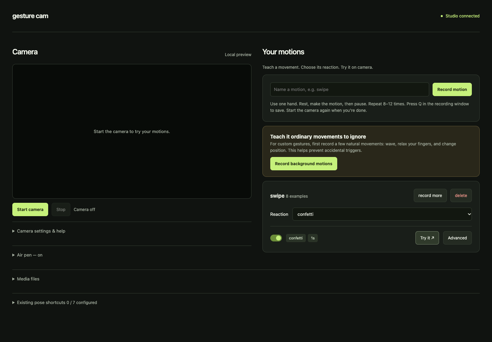

# Gesture Cam

Teach your webcam a movement, then give it a reaction. Record a swipe, wave, or circle and use it to trigger an effect during a call.



## Run it

Use Python 3.12:

```sh
git clone https://github.com/skier633/customreactionidk67.git
cd customreactionidk67
python3.12 -m venv venv
source venv/bin/activate
pip install -r requirements.txt
python studio.py
```

Studio opens at **http://localhost:5050**. Allow camera access when prompted. Tracking models download the first time you start the camera.

## Teach a motion

1. Record **background movements** first: ordinary hand movements that should do nothing.
2. Name a motion and click **Record motion**. Use one hand; rest, make the movement, and pause. Repeat 8–12 times. Press **Q** in the recording window to save.
3. Choose a reaction from the motion’s dropdown.
4. Click **Start camera** and try it. The preview shows the processed output, including your reactions.

Recording stops the preview so both processes do not compete for the camera. Start it again when you finish. Motions should last roughly 0.3–4 seconds; pauses over 0.3 seconds separate them. Both hands can be visible during live use and perform independent motions, but coordinated two-hand gestures are not supported.

Each motion has an **Advanced** editor for custom effects, timing, and experimental early firing. Choosing a simple reaction replaces its effect layers but keeps timing and recognition settings. Early firing can react before the ending pause, at the cost of more possible false alarms.

The **air pen** is optional and lives below the preview. Existing pose shortcuts remain in a separate collapsed panel. Your previous settings and recordings are preserved; presets are no longer part of Studio.

## Calls and camera help

On macOS, install [OBS Studio](https://obsproject.com/), start its virtual camera once, then stop it and quit OBS. Start Gesture Cam and choose **OBS Virtual Camera** in FaceTime, Zoom, or your call app.

Camera settings in Studio let you try another camera index. Close other camera apps if the camera cannot start. Startup and permission errors appear in the terminal. You can also run `python gesture_cam.py --camera 0` directly.

A virtual camera carries video only. To send your voice and reaction sounds to a call, install BlackHole 2ch (`brew install --cask blackhole-2ch`), restart your Mac, and select BlackHole as the call microphone. Reduce noise suppression if it cuts off the sounds.

Camera-window keys: **Q** quit, **C** clear ink, **P** toggle the pen, **D** tracking details, **H** preview controls.

## How it works

Gesture Cam compares the path of your wrist and changes in finger shape with your examples. Dynamic time warping allows the same movement to happen at different speeds while preserving its order. Unfamiliar or ambiguous matches are ignored. [Read the code walkthrough](docs/motion-matching.md).

Pose reactions pause only for the hand performing a motion. New motion recordings cannot be recovered from old pose samples because those do not contain the movement history. The old recorder is still available as `record_pose.py`.

Training checks whole held-out repetitions, or a separate recording session when available. Record another session under different lighting to get a stronger check. This score does not measure accidental triggers in a normal call.

## Measure accidental triggers

Real-call false triggers per minute: **not measured yet**. Train and configure your motions, stop the camera preview, then run:

```sh
python tools/evaluate_background.py --seconds 300
```

Talk normally for five minutes without intentionally making commands. The tool reports false triggers per minute, visible-hand coverage, and the settings used. It plays no effects and saves landmarks rather than video or audio. Pressing Q ends early and marks the report as a short session.

Replay a saved session after tuning:

```sh
python tools/evaluate_background.py --replay data/background/YOUR_SESSION.npz
```

Use a fresh conversation for final evaluation. A low count with your hands out of view, or zero triggers in one short session, does not establish reliability.

## Local data and development

Frames are processed locally. Studio and its preview server listen only on loopback; preview JPEGs stay in memory and are not saved to disk. Models download on first use. Recordings, settings, trained models, and uploaded media are ignored by Git.

```sh
pip install -r requirements-dev.txt
python -m pytest -q
```

Tests cover tracking, recorded pen clips, motion matching, pose coexistence, training, and Studio APIs. Live camera quality still depends on lighting and visibility.

[MIT license](LICENSE).
